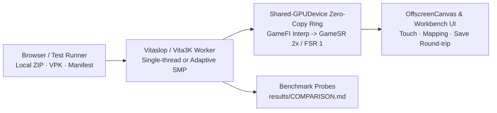

<p align="center">
  
</p>

<h1 align="center">PVSSPW · WebAssembly PS Vita Emulator Workbench &amp; Benchmark Suite</h1>

<p align="center">
  <a href="LICENSE"></a>
  
  
  <a href="https://pvsspw.cbnv.me/en/"></a>
</p>

<p align="center">
  <a href="README.md">简体中文</a> | <strong>English</strong>
</p>

<p align="center">
  <a href="https://pvsspw.cbnv.me/en/docs/">Online Docs</a> · <a href="docs-site/en/api-reference/index.md">API &amp; Probes</a> · <a href="repo-docs/README.md">Source Guide (ZH)</a> · <a href="results/COMPARISON.md">Comparison Report (ZH)</a> · <a href="ASSETS_LICENSES.md">Assets &amp; Licenses (ZH)</a>
</p>

**PVSSPW** (**P**layStation **V**ita **S**imulator **S**uitable for **P**laying on the **W**eb) is an experimental browser PlayStation Vita workbench and benchmark suite pairing a patched **Vitaslop** WebGPU/Wasm core with a PPSSPW-style UI shell, reproducible **Vita3K Web** baselines, and zero-copy **FrameFlow** (`GameFI` interpolation + `GameSR` 2× super-resolution) + **FSR 1** post-processing. All device/core findings for the *Madoka Magica: The Battle Pentagram* (`PCSG00214`) baseline are archived in [`results/COMPARISON.md`](results/COMPARISON.md).

## Capability Scope & Explicit Non-Goals

- **What it delivers**:
  - Builds patched single- and multi-threaded Vitaslop Wasm runtimes (resolving ARM jump-table & thread wakeup bugs, `libsas` firmware overlay packaging, and adaptive SMP thread-pool sizing benchmarked per title/device);
  - Provides a local workbench UI with ZIP/VPK library imports, HTTP Range 206 resumable downloads, rePatch/DLC toggles, confirmed save ZIP export/restore, keyboard/gamepad mapping, **FSR 1** scaling, and shared-`GPUDevice` zero-copy **FrameFlow** **`GameFI`** (`2×`/`3×`) + **`GameSR 2×`** enhancement (`web/frameflow-worker.js`);
  - Automates cold-start, first-frame, 600-second battle FPS, and GPU pixel-diff checks in headless Edge/Chromium and Android Firefox/Chromium.
- **What it explicitly does NOT do**:
  - **Zero bundled games, Vita firmware dumps, or PSN keys**: Test ZIPs and firmware extracts stay strictly local and gitignored;
  - **Zero cloud accounts or telemetry servers**: All library entries, saves, mappings, and benchmark JSON exports stay local inside browser storage / exported files;
  - **Hardware WebGPU gating & no unverified mobile extrapolation**: Neural `GameFI` / `GameSR` disables automatically in software rendering mode, and desktop/AVD measurements are reported separately from physical phone testing.

## Architecture Overview



## Quick Start & Verification

Requires Python 3.11+ and Node.js 22+ (plus Rust `1.98.0` / `wasm-bindgen-cli 0.2.126` when rebuilding Vitaslop Wasm):

```sh
# 1. Restore locked baseline player snapshots (93 files from bench/runtime/players.tar.gz) & install test deps
python3 scripts/prepare.py players
npm ci

# 2. Run pure-JS unit tests (thread policy, graphics fallback, telemetry probes)
node --test tests/*.test.mjs

# 3. Serve the patched Vitaslop workbench (with COOP/COEP headers) on 127.0.0.1:18747
python3 scripts/serve.py vitaslop --fixed

# 4. Run headless Edge workbench checks (Intel Xe-LPG Vulkan)
VK_DRIVER_FILES=/usr/share/vulkan/icd.d/intel_icd.json node tests/workbench.mjs --intel
```

Full setup instructions for game/firmware input hashing, Vitaslop Wasm patching (`scripts/build_vitaslop.py`), Android WebDriver/CDP benchmarks, and the 600-second *Battle Pentagram* reproduction workflow are documented in [`README.md`](README.md).

## License & Upstream Acknowledgments

- First-party shell UI, FrameFlow worker integration, scripts, tests, and documentation are licensed under [GNU AGPLv3](LICENSE) (`AGPL-3.0-only`).
- Upstream **Vitaslop** remains under the **MIT License** ([`web/vitaslop-license.txt`](web/vitaslop-license.txt), [`bench/runtime/vitaslop-LICENSE.txt`](bench/runtime/vitaslop-LICENSE.txt)); the **Vita3K Web** comparison snapshot remains under **GPL-2.0-or-later** ([`bench/runtime/vita3k-LICENSE.txt`](bench/runtime/vita3k-LICENSE.txt)).
- Vendored runtime notices, derived PPSSPW shell files, FrameFlow (`GameFI`/`GameSR`) runtime & models, Lucide (`ISC`), and IBM Plex Sans (`SIL OFL 1.1`) attributions are recorded in [`web/vendor/NOTICE.txt`](web/vendor/NOTICE.txt) and [`ASSETS_LICENSES.md`](ASSETS_LICENSES.md).
- **Additional Terms & Asset Rules**: First-party portions are governed under GNU AGPLv3 Section 7 by [`LICENSE-ADDITIONAL_TERMS-zh-CN.md`](LICENSE-ADDITIONAL_TERMS-zh-CN.md) (v1.6.7-r4, authoritative Chinese text; English reference in [`LICENSE-ADDITIONAL_TERMS-en.md`](LICENSE-ADDITIONAL_TERMS-en.md)) and [`IMPLEMENTATION-GUIDE.zh-en.md`](IMPLEMENTATION-GUIDE.zh-en.md). Third-party materials without express consent remain governed solely by their original licenses.
