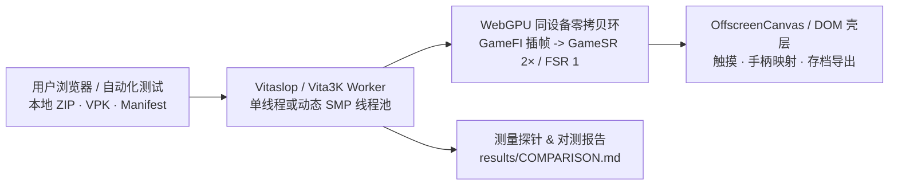

<p align="center">
  
</p>

<h1 align="center">PVSSPW · PS Vita 网页模拟器与性能对测平台</h1>

<p align="center">
  <a href="LICENSE"></a>
  
  
  <a href="https://cybernova2333.github.io/pvsspw/"></a>
</p>

<p align="center">
  <strong>简体中文</strong> | <a href="README.en.md">English</a>
</p>

<p align="center">
  <a href="https://cybernova2333.github.io/pvsspw/docs/">在线文档站</a> · <a href="docs-site/api-reference/index.md">API 与探针参考</a> · <a href="repo-docs/README.md">源码指南</a> · <a href="results/COMPARISON.md">设备与核心对比表</a> · <a href="ASSETS_LICENSES.md">资产与许可清单</a>
</p>

修复版 Vitaslop 使用 PPSSPW 风格的游戏库、触控和存档界面。本机启动与日版样例的操作见 [PVSSPW 游玩界面](#pvsspw-游玩界面)。

用同一份《剧场版 魔法少女小圆 The Battle Pentagram》日版（PCSG00214 v01.00），比较 Vitaslop 和 Vita3K Web 的冷启动、战斗场景持续帧率及游戏内存读档。实测记录见 [设备与核心对比表](results/COMPARISON.md)，表内链接指向对应的设备、输入指纹、启动阶段和播放器诊断。

沿用隔壁 PPSSPW 的做法，每次试跑记录构建指纹、设备类别和固定场景，先保存原始结果，再生成比较表。对应的参考入口是 [PPSSPW 场景会话](../ppsspw/scripts/browser-scene-session.mjs) 和 [PPSSPW 性能比较](../ppsspw/scripts/compare-browser-performance.mjs)。两个 PSV 核心使用各自的渲染提交信号。

## 能力边界与明确非目标

- **能做到什么程度**：
  - 在锁定提交的 Vitaslop（`MIT`）上补齐 ARM 跳转表修复、协程唤醒、`libsas` 覆盖、单/多线程 Wasm 构建及每局并行 CPU 测速选线程，提供纯本地回环游玩与对测工作台；
  - 集成零拷贝共享 `GPUDevice` 的 **FSR 1 空间超分**、**FrameFlow `GameFI` 实时光流插帧**（`2×` / `3×`）与 **`GameSR` 2× 超分**，可单独或串联启用并在工作台即时生效；
  - 提供桌面无头 Edge/Chromium（含 Intel Xe-LPG / SwiftShader 对照）与 Android Firefox/Chromium 的冷启动、首帧与 600 秒战斗持续帧率/逐像素帧更新采样流水线。
- **明确不做什么**：
  - **绝不分发商业游戏 ROM、Vita 固件或 PSN 密钥**：所有测试镜像 ZIP、rePatch 与固件包均由用户本地提供并保留在忽略目录；
  - **不包含联机联调后台或强制云端依赖**：工作台所有玩家游戏库、存档、按键映射与测量导出全部离线保存在浏览器本地；
  - **无硬件 WebGPU 时不强行跑 AI 后处理或高帧率软渲**：软件渲染模式自动禁用 `GameFI` / `GameSR`，桌面实测结论不未经实机直接外推至实体手机帧率。

## 工作台与后处理架构



## 准备

需要 Python 3.11+。自动化桌面和 Android Chromium 测试还需 Node.js 22+、npm 和 Chromium。Android Firefox 使用 ADB、测试设备上的 Firefox 和 geckodriver。交互式测试只需 Python 和浏览器。

```sh
python3 scripts/prepare.py players
python3 scripts/prepare.py inputs --archive ../../resources/TheBattlePentagram_JPN.zip
npm ci
```

第一条命令从仓库自带的 [静态播放器快照](bench/runtime/README.md) 还原 93 个文件并校验指纹，可离线运行。第二条校验原始归档，提取本体的 62 个文件，按固定顺序和时间戳打包。输出在 `.cache/pvsspw/inputs/`。两端使用完全相同的 `PCSG00214.zip`。Vita3K Web 额外导入同一归档内的 `os0`、`vs0`、`sa0` 生成的 `firmware.zip`。桌面模拟器、DLC、着色器缓存和旧存档均在提取范围外。[输入指纹](bench/sample.lock.json)

分别在两个终端启动播放器。固定且不同的端口隔离两个核心的游戏库与存档。服务只监听回环地址，提供跨源隔离所需的 COOP/COEP 响应头。

```sh
python3 scripts/serve.py vitaslop
python3 scripts/serve.py vita3k
```

| 播放器 | 本机入口 | 首次导入 |
|---|---|---|
| Vitaslop | [端口 18741](http://127.0.0.1:18741/) | Add games → Zip，选择 PCSG00214.zip |
| Vita3K Web | [端口 18742](http://127.0.0.1:18742/) | Import firmware 选择 firmware.zip，完成后 Import a game 选择 PCSG00214.zip |

## 在桌面 Edge 复现修复版

完成上面的播放器还原、日版样例准备和 `npm ci` 后，在装有 Microsoft Edge 的 Linux Intel 机器上执行。构建脚本检出锁定的 Vitaslop 提交，应用源码补丁，构建单线程和多线程 Wasm，并从本地同版固件生成只含 `libsas.suprx` 的覆盖包。构建所需工具如下。

```sh
rustup toolchain install 1.98.0 --target wasm32-unknown-unknown --component rust-src
cargo +1.98.0 install --locked wasm-bindgen-cli --version 0.2.126
python3 scripts/build_vitaslop.py
python3 scripts/serve.py vitaslop --fixed
```

保留服务，在另一个终端运行。Playwright 使用独立的空配置启动无头 Edge，校验硬件适配器与输入指纹，通过播放器界面导入游戏和固件覆盖包，再点 Play。输出目录每次取新名称。

```sh
VK_DRIVER_FILES=/usr/share/vulkan/icd.d/intel_icd.json \
  node scripts/run.mjs vitaslop --channel msedge --fixed --intel-vulkan --gl-compositor \
  --capture-game --screen-evidence --boot-seconds 35 --output artifacts/edge-first
```

`game-*.png` 是游戏提交纹理的定期取样，`canvas-*.png` 是 Edge 合成后的画面。原始时间戳、适配器、Wasm 指纹和游戏 SHA-256 在同目录的 `run.json`。延长到 155 秒可观察片头和标题。手工运行可在下方工作台导入本体及 rePatch。自动化对测继续使用同一来源上的 `/core.html` 原生管理界面。[修复版入口](http://127.0.0.1:18747/) · [桌面首帧记录](results/DESKTOP-FIRST-FRAME.md)

桌面修复版还可在上述 Edge 命令中加上 `--touch-viewport`，使用 844×390 的横屏、2 倍像素密度和触摸输入，并通过轻触 Play 启动。报告会单列为桌面触摸模拟；手机实测使用实际设备的 GPU 和浏览器。

## PVSSPW 游玩界面

启动修复版服务后打开 [PVSSPW 工作台](http://127.0.0.1:18747/)。首次游玩《战斗的五芒星》时点「选择游戏」导入 `.cache/pvsspw/inputs/PCSG00214.zip`，在该游戏卡片点「导入 rePatch」，选择同目录的 `vitaslop-sas.zip`。卡片显示「rePatch 已启用」后点「开始游玩」。此前在同一来源导入的游戏和游戏内存档也能在工作台使用。

右上角「游戏库与设置」提供八个页签。窄屏的配色开关在「画质与操作」，全屏时可点顶部的「···」打开手柄、存档或游戏库。PS Vita 双摇杆、背面触控、按键映射和游戏内存档由 Vitaslop 处理。「我的存档」支持单个游戏或当前配置的全部存档 ZIP，恢复前会列出目标并请求确认。核心暂未提供即时状态槽。

「在线下载」接受本地 JSON 或 HTTPS 清单。沿用 PPSSPW 的版本 1 格式，字段为 `schemaVersion`、`id`、`name`（ZIP 或 VPK）、`size`、`chunkSize`、每块的 `sha256` 数组和镜像 `sources`。来源需支持 HTTP Range 和 206 响应，跨域时还须开放 CORS 及 `Content-Range` 响应头。重新载入同一清单可继续已校验的进度。完成后点「导入游戏库」。

游戏卡片的「详情与附加内容」可以安装、启停和移除 rePatch 或附加内容。「画质与操作 → 键盘与手柄映射」可保存全局或单游戏配置。这两个页面、启动画面、暂停菜单和运行中断提示均使用 PVSSPW 界面。「画质与操作 → 画面」提供 **FSR 1 超分**、**AI 插帧 (GameFI)**（`2× · Lite/Std`、`3× · Lite`）与 **AI 超分 (GameSR 2×)**（`Lite/Std`）开关：其中 FSR 1 接在 Vitaslop 最终 WebGPU 显示通道上，开启后自动切至「匹配屏幕像素」输出；`GameFI` 与 `GameSR` 通过 `web/frameflow-worker.js` 零拷贝复用共享 `GPUDevice`，支持单独开启或串联生效，且软件渲染模式下自动禁用以避免降帧。

**Edge 显示 WebGPU 不可用时**，点「查看启动问题 → 重新检测」。工作台在渲染工作线程中依次试用图形设备并创建 WebGPU 设备，记录请求结果。若浏览器只提供软件设备，可以确认以软件渲染启动。桌面 Edge 可在 `edge://settings/system` 检查图形加速，重启后在 `edge://gpu` 检查 WebGPU 状态。[微软图形加速排查说明](https://learn.microsoft.com/en-us/troubleshoot/microsoft-edge/performance/edge-high-cpu-memory)

本机 Linux 的默认 Edge 157 未提供适配器。已经打开的个人 Edge 会接收后来启动命令的地址，继续沿用原进程的图形参数。项目的 Linux 启动器使用专用配置目录、Vulkan 和 GL 合成。在这台机器上它选择 Intel Xe-LPG。已有的个人 Edge 可同时使用。专用窗口的游戏和存档保存在 `$XDG_DATA_HOME/pvsspw/edge-player`，默认位于 `~/.local/share/pvsspw/edge-player`。跨配置转移存档可使用「我的存档」导出和恢复。

```sh
python3 scripts/open-edge.py
```

本机服务通过 `python3 scripts/serve.py vitaslop --fixed --edge-launcher` 启动时，默认 Edge 的[启动诊断](http://127.0.0.1:18747/#/diagnostics)也提供「打开 WebGPU 游玩窗口」。此入口只接受同源页面在本机回环地址发起的请求。

「系统诊断」显示核心报告的帧率与 WebGPU 提交次数，可以手动开始、停止和导出逐秒性能采样。可辨识首帧、固定场景十分钟和游戏内重开读档仍按下方对测口径，在 [修复版对测入口](http://127.0.0.1:18747/core.html) 记录。

以下验收使用 Playwright 无头 Microsoft Edge 和独立临时浏览器配置。默认验证桌面和横竖屏触摸模拟、下载续传和合成存档备份。加入 `--game` 后通过工作台实际导入上面的日版样例和 rePatch，并验证游戏画面、暂停、截图、屏幕手柄和诊断导出。截图写入 `artifacts/workbench/`。

```sh
node tests/workbench.mjs
VK_DRIVER_FILES=/usr/share/vulkan/icd.d/intel_icd.json node tests/workbench.mjs --game --intel --pentagram-menu
VK_DRIVER_FILES=/usr/share/vulkan/icd.d/lvp_icd.json node tests/workbench.mjs --game --software
```

`--pentagram-menu` 从 OP 进入游戏内「オプション」，按截图核对方向键逐项移动。测试会临时降低渲染提交速率，再测慢点、长按和松手。工作台的「画质与操作 → 屏幕方向键」可选择「只单步」，手指停留多久都只触发一次。

工作台在手机和桌面上均默认开启多线程。优先采用同一游戏与设备配置的实测值。日版《战斗的五芒星》在已测的 Linux x86-64、Edge 157、Intel Xe-LPG 硬件 WebGPU、24 个逻辑处理器、浏览器报告 32 GiB 设备内存的组合上使用 3 个游戏执行线程。

其他组合在每次开局时按浏览器报告的逻辑处理器数量和设备内存容量提示估算 2–6 个游戏执行线程的上限。上限超过 2 时，用短时并行 CPU 测速比较候选数量，取吞吐量达到最佳值 90% 的最小线程池。测速超时（1.2 秒）或不可用时，在预算内选择最多 3 个。核心在开局时创建线程池，本局保持该数量。可在「系统诊断 → 游戏线程」查看本局数量及选择依据。

手动对测可在「详情与附加内容 → 按键映射 → 核心高级设置」的运行参数中填写 `VITASLOP_SMP_WORKERS=3` 来固定游戏执行线程数（可选 1–8），或填 `VITASLOP_SMP=0` 测单线程核心。保存后重新启动游戏。清除手动参数后，下次启动会重新自动选取。[设备与核心对比表](results/COMPARISON.md)

本轮界面验收使用无头 Microsoft Edge。桌面 Intel Xe-LPG 与显式开放 SwiftShader 的独立测试配置均已从新游戏库启动 PCSG00214，显示日文「ご注意」并导出游戏截图。软件模式从核心的游戏纹理读取像素，在二维画布上每秒最多呈现 30 帧。系统诊断另行统计核心提交次数。[硬件模式](results/frames/workbench-edge/game.png) · [软件模式](results/frames/workbench-edge/software-game.png)

桌面触摸模拟已验证 390×844 与 844×390 布局，以及横屏虚拟按键的按下和释放。存档备份使用合成存档，已验证恢复、重开与逐字节导出。Android 实体手机仍待验证。[游戏详情](results/frames/workbench-edge/game-details.png) · [按键映射](results/frames/workbench-edge/mapping.png) · [暂停菜单](results/frames/workbench-edge/pause-menu.png) · [桌面横屏触控截图](results/frames/workbench-touch.png)

## 自动跑冷启动

桌面默认使用 Playwright 的无头 Edge 通道和独立配置，观察窗口默认 180 秒。下面的命令显式指定 Chrome for Testing，用于复现较早的 Linux Intel 桌面基线。其他 GPU 或系统使用其本机 Chromium，可省略 Vulkan 参数。输出目录应是新目录。冷启动结果、可用 GPU、首帧信号和失败现场在 `artifacts/<试次>/`。应用未出帧也会生成结果 JSON。

```sh
export PV_CHROME="$HOME/.cache/ms-playwright/chromium-1254/chrome-linux64/chrome"
export VK_DRIVER_FILES=/usr/share/vulkan/icd.d/intel_icd.json
node scripts/run.mjs vitaslop --chrome "$PV_CHROME" --intel-vulkan --output artifacts/desktop-a
node scripts/run.mjs vita3k --chrome "$PV_CHROME" --intel-vulkan --output artifacts/desktop-b
```

上述历史基线浏览器为 Chrome for Testing 158.0.8127.18（Linux x86_64）并以 headless 模式运行。上例给出本机该版本路径；在其他机器将 `PV_CHROME` 指向相同版本的可执行文件。

Android Firefox 的两次测试分别建立 WebDriver 会话。脚本将归一化 ZIP 送入所选设备的测试目录并在客体再次校验 SHA-256，然后通过播放器自身的文件选择框导入。首次向导选择跳过登录，出现本地测试来源的持久存储请求时允许存储。本轮使用 Android 14/API 34、x86_64、Firefox 160.0.1、geckodriver 0.37.1。AVD 使用 SwiftShader 并关闭虚拟 Vulkan，实体手机应保留自己的默认驱动。

要复现本轮虚拟设备配置，使用 Android Emulator 37.2.13 和 `system-images;android-34;google_apis;x86_64` 创建名为 `Android14_x86_64` 的 AVD。本轮客体数据区容量为 10 GiB。本机的宿主 GPU 模式未能启动该 AVD。实际完成对测的启动命令如下。Firefox APK 的 SHA-256 为 `283b19f8313e8ce6e8a913bb178ce4a79c5cecd82c49f821de7fafb068c73fcd`。

```sh
emulator -avd Android14_x86_64 -port 5572 -read-only -no-snapshot -no-window \
  -no-audio -no-boot-anim -cores 3 -memory 3072 -gpu swiftshader -feature -Vulkan
```

```sh
adb devices -l
export PV_SERIAL=emulator-5572
# 在单独终端运行。使用专用测试设备或测试配置。
geckodriver --port 18744 --marionette-port 18745 --websocket-port 18746 --android-storage internal
# 保持两个播放器服务和 geckodriver 运行。
python3 scripts/firefox_android.py vitaslop --serial "$PV_SERIAL" --output artifacts/android-a
python3 scripts/firefox_android.py vita3k --serial "$PV_SERIAL" --output artifacts/android-b
```

Android Chromium 可用 ADB 反向转发和浏览器 CDP 连接。在独立终端用 `--local-inputs` 启动两个播放器服务，使测试浏览器能从回环地址分块暂存 ZIP。先启动测试浏览器并完成首次向导。套接字以该浏览器实际提供的名称为准。

```sh
adb -s "$PV_SERIAL" reverse tcp:18741 tcp:18741
adb -s "$PV_SERIAL" reverse tcp:18742 tcp:18742
adb -s "$PV_SERIAL" shell cat /proc/net/unix | grep devtools_remote
adb -s "$PV_SERIAL" forward tcp:18743 localabstract:chrome_devtools_remote
node scripts/run.mjs vitaslop --android "$PV_SERIAL" --cdp http://127.0.0.1:18743 --output artifacts/chromium-a
node scripts/run.mjs vita3k --android "$PV_SERIAL" --cdp http://127.0.0.1:18743 --output artifacts/chromium-b
```

Chromium 的冷启动流程要求该来源没有已安装游戏。重跑用新的测试浏览器配置，保留需要测读档的旧配置。两个核心依次运行，记录浏览器版本、电源状态和设备。ADB 连接本身只证明连接了一个 Android 客体；虚拟机和未经人工确认机型的 ADB 设备会分别标注。

## 实体手机与测量口径

Android 可直接在手机浏览器打开 ADB 转发的回环入口并手工导入。iPhone Safari 可通过 HTTPS 反向代理访问两个本地服务，使用两个独立来源，保留 COOP/COEP 响应头。用「文件」选择同一份已校验的输入。移动设备的局域网明文 HTTP 无法提供所需的安全上下文。

在同一 Wi-Fi 上，可将以下内容保存为 Caddyfile，把示例 IP 换成电脑的局域网 IP。保持上面的两个播放器服务以默认参数运行，再执行 `caddy run --config Caddyfile`。在测试手机上安装并信任该 Caddy 实例的本地根证书，分别用 Safari 打开两个 HTTPS 地址，游戏 ZIP 和固件 ZIP 通过「文件」从手机本地选择。这条 iPhone 流程待实机验证。

```caddyfile
https://192.168.1.10:19741 {
    tls internal
    reverse_proxy 127.0.0.1:18741
}
https://192.168.1.10:19742 {
    tls internal
    reverse_proxy 127.0.0.1:18742
}
```

1. **首帧。** 使用完成导入、从未运行过该游戏的测试配置。从按下 Play 计时。Vita3K Web 记录游戏 Worker 的 `vita-present` / `vita-frame`，Vitaslop 记录写入游戏画布纹理的 GPU 命令首次成功提交。两者都可能先呈现黑帧。看到可辨识的游戏画面后，点左下「PVSSPW 对测 → 确认游戏画面」。自动化只记录提交信号，截图另供核查。
2. **持续帧率。** 两端使用默认设置，在日版第一场可控战斗、HUD 完整出现、角色位于出生点时开始 600 秒采样，保持前台、相同视角和输入（本场景保持静止）。每秒帧数按整个窗口内的呈现次数除以 600 计算。阵亡、切关或意外进入菜单时点「场景变化，作废本轮」。切后台或离开游戏会使采样失效。未进入该场景时结果留空。不同渲染路径的提交计数也不代表屏幕实际扫描输出。
   桌面 Edge 的像素对测另外使用 `scripts/battle.mjs`。采样器在 GPU 上逐像素比较相邻两张游戏输出的 RGB，第一张作为参照。每个完整 600 秒窗口分别记录整幅不同画面数、中央一半宽高矩形内的不同画面数、提交次数和每分钟计数。静止时间也计入分母。原生画面与宿主 UI 分开，桌面显示器的扫描输出没有参与计数。
3. **游戏内存档与读回。** 在游戏中存入一个明确的槽位，记下章节和可辨识进度，点「记录游戏内写档」并导出本次 JSON。关闭标签页，在相同浏览器配置、相同来源重新打开游戏，从游戏菜单读档。确认相同角色与进度后点「确认重开后读回」并再次导出。探针检查本次文档与写档文档不同、进度标记一致。这个结论来自操作者验证；游戏库条目、OPFS 文件或导入成功本身不能证明读档成功。
4. **证据归档。** 手工导出填写实体机或虚拟机、机型、系统、浏览器版本；另记画质设置、电源状态及是否发生发热降频。自动化输出在 `artifacts/`，保留 JSON 和截图。选择已核实的试次保存至 `results/runs/`，在 `results/cases.json` 的 `file` 填入冷启动记录、可选 `reloadFile` 填入同次写档的重开读回记录，随后执行 `python3 scripts/report.py` 生成对比表。实体机只有在确认实际硬件后登记。

```sh
node --test tests/probe.test.mjs
python3 scripts/report.py
```

测量探针仅在本地服务响应时插入。修正核心或调整浏览器图形开关时需另建试次，并记录差异。游戏和固件仅保存在本机忽略目录里。


### 复测日版第一场战斗

在 Linux Intel 硬件上完成上面的输入准备后，构建对测版本并启动本地服务。

```sh
python3 scripts/build_vitaslop.py --battle
python3 scripts/serve.py vitaslop --fixed --battle
```

另开终端，以独立的测试配置启动 Playwright 无头 Edge。每次试次使用空的输出目录，单线程和多线程依次运行。

```sh
export VK_DRIVER_FILES=/usr/share/vulkan/icd.d/intel_icd.json
export PV_BATTLE_URL=http://127.0.0.1:18751
node tests/picture-rate.mjs
node scripts/battle.mjs single artifacts/verify-single
```

启动器会核对日版 ZIP 的 SHA-256，导入游戏与 rePatch，并写出 `ready`。从另一个终端向该目录下的 `action` 写一行命令，格式是「唯一截图名 操作 参数」。例如 `printf '%s\n' 'prologue story' > artifacts/verify-single/action` 会进入序章。每次等到同名 JPG 出现后再发下一条。用 `look` 查看现场，`key circle 100` 向游戏发送一次 100 毫秒的 ○，`stick 0 720` 向左推摇杆 720 毫秒。本次实测在教学提示出现后按 START，看到「わたしのはじまり」第一階層暂停菜单，目标为「すべての使い魔を倒せ！」。选「ゲームに戻る」，用 ○ 翻完教学说明。保持摇杆中立，用 `jump-proof key cross 115` 拍到小圆跳起，落地后用 `landed look` 核对出生点、镜头和完整 HUD。

发送 `battle-start sample 600` 开始计时。保持页面前台、角色静止，核对每分钟的截图和 `window-end.jpg`。切场景、阵亡或打开菜单时发送 `invalid discard` 作废。有效试次会在 `measurement.json` 中写出结果。以 `done exit` 关闭浏览器后，用 `multi` 和另一个空目录重做固定 3 个游戏执行线程的历史对照，或用 `auto` 测试随设备自动选取的线程数。例如 `node scripts/battle.mjs multi artifacts/verify-six 6` 可复测 6 个线程。实际运行参数见该次 `battle-start-setup.json`。

复测 FSR 1 开关对照时，使用 `PV_FSR_COMPARE=1 node scripts/battle.mjs multi artifacts/verify-fsr` 进入同一出生点并验证跳跃落地，随后发送 `fsr fsr-compare`。脚本会将视口固定为 1440×900（输出纹理 1440×816），先在同一游戏帧采得无损原图三元组，再经界面开关顺序执行各 600 秒的 GPU 逐像素帧率对照并核验 `present-scale` 与 `fsr1-easu`/`fsr1-rcas` 通道计数。

## 许可与上游致谢

- 本项目第一方前端外壳、测试与编排脚本依据 [GNU AGPLv3](LICENSE)（`AGPL-3.0-only`）条款发布。
- 上游 `Vitaslop` 依据其原有 **MIT 许可证**分发（见 [`web/vitaslop-license.txt`](web/vitaslop-license.txt) 与 [`bench/runtime/vitaslop-LICENSE.txt`](bench/runtime/vitaslop-LICENSE.txt)）；对照测试快照中的 `Vita3K Web` 沿用其 **GPL-2.0-or-later** 许可（见 [`bench/runtime/vita3k-LICENSE.txt`](bench/runtime/vita3k-LICENSE.txt)）。
- 随静态界面整合的 `FrameFlow`（`GameFI` / `GameSR` 运行时与紧凑模型）、派生界面及字体、图标许可边界见 [`web/vendor/NOTICE.txt`](web/vendor/NOTICE.txt)、[`web/vendor/LICENSE.TXT`](web/vendor/LICENSE.TXT) 与 [`ASSETS_LICENSES.md`](ASSETS_LICENSES.md)。
- **附加条款与资产规则**：本项目第一方原创部分依据 GNU AGPLv3 第 7 条适用 [`LICENSE-ADDITIONAL_TERMS-zh-CN.md`](LICENSE-ADDITIONAL_TERMS-zh-CN.md)（v1.6.7-r4；英文参考译文：[`LICENSE-ADDITIONAL_TERMS-en.md`](LICENSE-ADDITIONAL_TERMS-en.md)，以简体中文完整版正文为准），工程实施参考见 [`IMPLEMENTATION-GUIDE.zh-en.md`](IMPLEMENTATION-GUIDE.zh-en.md)，人员署名、AI 辅助工具、上游依赖与字体/标识资产清单见 [`ASSETS_LICENSES.md`](ASSETS_LICENSES.md)。未取得对应权利人明确授权的第三方材料仍受其原有有效许可证约束。

