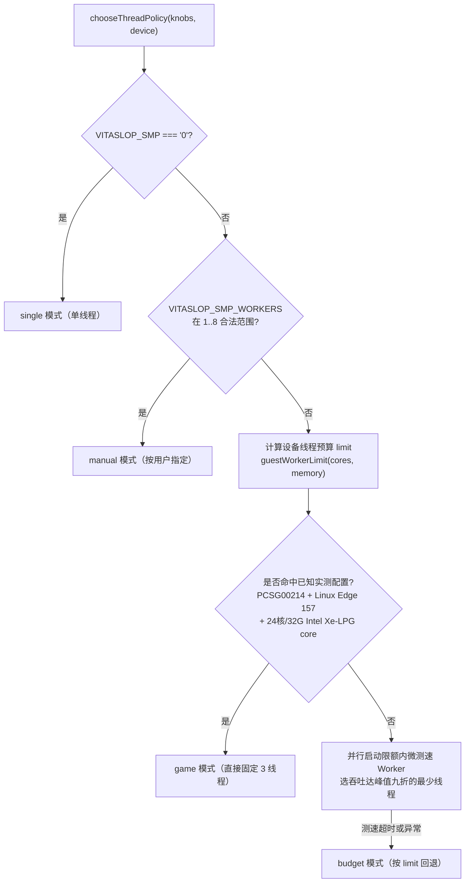

# Vitaslop 补丁栈与自适应线程策略

将原版上游 Vitaslop 纳入网页对测工作台，需要解决两大工程瓶颈：原提交运行特定商业游戏时在指令译码与协程唤醒阶段直接报错中断，且多核环境盲目创建过多 WebAssembly 工作线程反而在浏览器核显场景下产生调度内耗。PVSSPW 通过递增源码补丁与启动前自适应微基准同时化解这两个问题。

## 四段式可核对补丁栈构建 (`build_vitaslop.py`)

为维持上游 MIT 代码许可边界清晰，仓库不检出修改过的完整 Vitaslop 文件，而是保存四段递增补丁：
1. **`vitaslop-firmware.patch`**：修补模块加载与重定位逻辑，并在内核映射层追加基础字符串长度等符号支持，为挂载系统外部模块扫清障碍。
2. **`vitaslop-playback.patch`**：修正输入控制键位状态同步、视音频播放句柄读取流控及外部可覆盖参数表。
3. **`vitaslop-battle.patch`**：针对 `Battle Pentagram` 战斗切入崩溃问题，修正 ARM 跳转表识别分支以及协程在等待内核线程信号唤醒时的丢失缺陷。
4. **`vitaslop-fsr1.patch`**：在显示后端接入原生两通道 WGSL 空间放大器（EASU + RCAS）。

在构建期间，`apply_stack` 利用隔离的临时 Git 索引逐个预演补丁树哈希；如果开发者工作目录正停留在某一完整前缀之上，脚本只继续应用剩余未合入补丁，一旦检测到无关散乱修改即刻中止防止混淆基线。同时，`make_overlay` 会校验本地提取固件中的 `libsas.suprx` 摘要，生成结构确定的独立 `vitaslop-sas.zip` 覆盖包，保证复现测试时核心不直接夹带固件转储进入产物目录。

对应源码：[核心构建脚本](../../scripts/build_vitaslop.py) 与四份[补丁集](../../patches/vitaslop-battle.patch)。

## 启动期自适应线程决策 (`thread-policy.js`)

核心启动时即一次性分配好共享调度器并绑定线程；一旦进入游玩便不能热更池大小。因此 `chooseThreadPolicy` 必须在每次打开游戏前依据配置优先级完成确定性选型：

这一分层判定背后的实测动因直接记录在代码注释与单元测试中：
- `guestWorkerLimit(cores, memoryGiB)` 固定从 CPU 总核心数中减去 2（为宿主渲染呈现线程与浏览器调度留出余量），并受内存分档约束（2 GiB 以下上限 2 个、4 GiB 以下上限 4 个、更高内存上限 6 个，与 Vita 三颗应用核心各自配双工位对应），最终钳位在不低于 2 的整数上。
- `measureParallelism` 按二至上限递增及逆序双趟测算纯并行算力，再由 `selectWorkerCount` 取吞吐达到最大实测值九折时的**最小**线程池规模，避免多出的线程数只带来微弱增益却增加跨 Worker 争用。
- 如果微基准在 1.2 秒内超时或发生运行时异常，`chooseThreadPolicy` 自动退回到计算得到的 `budget` 线程上限保证启动不中断。

对应源码：[线程策略模块](../../web/thread-policy.js) 与 [策略单测](../../tests/thread-policy.test.mjs)。后续渲染呈现与同设备后处理协同细节见[FSR 1 与 FrameFlow 同设备零拷贝管线](frameflow-and-fsr1-pipeline.md)，改动定位回到[按职责找代码](../code-map.md)。

证据状态：除特别标注外，本页基于当前源码已确认；24 核 Intel Xe-LPG 三线程高于六线程的具体对战成绩依据源码注释与既有对比表。
