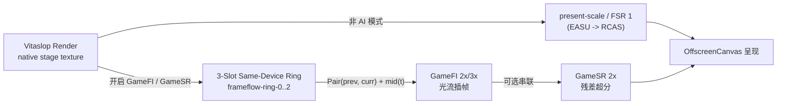

# FSR 1 与 FrameFlow 同设备零拷贝管线

在浏览器中对模拟器输出帧施加空间锐化或时间域插帧时，若在核心图形上下文与后处理引擎之间通过内存画布中转或反复回读像素，不仅产生巨额显存往返延迟，还会直接把模拟器核心拖垮。PVSSPW 同时集成了原生 Rust 侧 FSR 1 与外挂 JavaScript 侧 FrameFlow（`GameFI` 光流插帧 + `GameSR` 二倍超分），两者均在同一逻辑 `GPUDevice` 上实现显存零拷贝衔接。

## 原生两通道 FSR 1 空间上采样 (`vitaslop-fsr1.patch`)

FSR 1 位于 Vitaslop 的原生 Rust 显示模块内，作为纯渲染后端叠加通道附加在既定展示纹理解之后，绝不反过来改变客户端内部渲染目标分辨率或线程节拍：
- **Pass 1 (`fsr1-easu`)**：读取原始游戏显示纹理并采用边缘自适应空间上采样渲染到与屏幕目标分辨率一致的 `Rgba8Unorm` 临时纹理 `fsr1-scratch`。
- **Pass 2 (`fsr1-rcas`)**：在临时纹理上执行自适应锐化并直接写入目标屏幕视图，尺寸随窗口调整动态重建中间缓冲。
- **验证锚点**：通道均带有清晰的调试标签 `fsr1-input`、`fsr1-easu`、`fsr1-rcas` 及 `present-scale`，测试脚本据此从同帧图形流直接切出三路对比画面，确认画质提升且不篡改内部像素基线。

对应源码：[FSR 1 核心补丁](../../patches/vitaslop-fsr1.patch) 与 [对测通道对比](../../bench/fsr-passes.js)。

## 同设备三槽环拦截与 FrameFlow 接入 (`frameflow-worker.js`)

为了使纯前端的 `GameFI` 插帧模型与 `GameSR` 2× 超分模型在不修改 Vitaslop 编译产物的情况下直接消费原生游戏渲染输出，游戏 Worker 在启动时严格按「先加载 `frameflow-worker.js`、再加载 `worker-probe.js`、最后启动 `worker.js`」的模块顺序装配，围绕原生 WebGPU 原型执行四项职责：

1. **按需激活十六位浮点计算 (`shader-f16`)**：拦截适配器请求，在硬件非软件光栅模式且驱动公布支持时，尝试将 `shader-f16` 并入逻辑设备请求特性中，为半精度着色器核提速；若底层驱动拒绝与其他限额联用，则平滑回退到常规设备创建流程，避免黑屏崩溃。
2. **三槽同设备纹理环接管 (`ensureRingAndSession`)**：当任意一项 AI 后处理启用的同时，将核心请求主画布纹理的调用分流进本地预先创建的三个同格式、带渲染附着与纹理绑定标志的环槽 `frameflow-ring-0..2`，并覆写这组纹理的销毁钩子防止客体丢弃引用时过早回收。
3. **动态分辨率与节拍保护**：针对 1280×720 以上画面或降档 tier 自动把光流内部工作尺度约束为较低网格，在串联使用场景下严格把帧流插帧置前、二倍超分或展示放大置后，通过定时器与指数平均源帧间隔协调中间帧单调呈递。
4. **互斥与软件渲染安全门禁**：引擎外壳层在传递设置时显式把原生 `fsr1` 开关和 AI 超分 `srActive` 设为互斥，确保开启 `GameSR` 时自动压制传统 FSR 1；一旦检测到软件渲染适配器，AI 预设均强制静默置为关闭，绝不让软件计算卡死游戏核心。

对应源码：[后处理拦截协调器](../../web/frameflow-worker.js) 与 [引擎参数协商](../../web/engine.js)。有关底层预览隔离头、样本指纹准备及画面对测制表流程见[工作台存档、预览服务与自动对测](benchmark-and-workbench.md)与[按职责找代码](../code-map.md)。

证据状态：除特别标注外，本页基于当前源码已确认；`web/vendor/frameflow/` 内部着色器核详情参阅 `frameflow` 上游指南。
