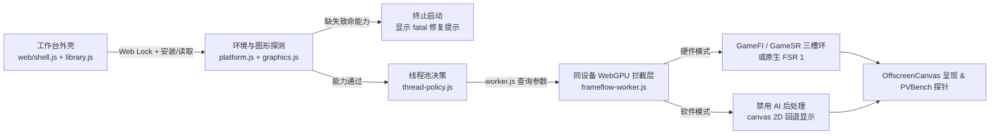

# PVSSPW：一次真实主流程

玩家打开工作台并选中本地游戏镜像后，页面壳层必须先完成存储同步锁申请、浏览器底层特性核查、图形适配器选择以及核心工作线程池规划，才能把执行控制权交给同域引擎框架与 WebAssembly 工作线程，并在最终呈现端协调空间放大与神经网络插帧、超分。本指南沿本地启动一台游戏的真实过程追踪这些交接。

难点在于多个异步线程与共享存储之间存在严格依赖：如果另一标签页正在占用本地游戏库、浏览器缺失同步文件句柄能力、或者只有软件光栅渲染器却试图启动 AI 后处理，系统必须在核心进入渲染循环前就完成拦截、降级或清理，不能把半启动状态残留在工作线程里。

下表概括源码中主要输入与运行分支的对应关系：

| 输入或状态 | 动作与结果 |
| --- | --- |
| 具有安全上下文、OPFS 同步句柄与硬件 WebGPU | 完成安装与选线程，开启同设备渲染并允许按需启用插帧、超分或 FSR 1 |
| 浏览器仅有软件渲染适配器（SwiftShader 等） | 自动标记 `uiPresent=software` 并强制关闭 `GameFI` 与 `GameSR`，改走二维画布呈现 |
| 另一同源标签页持有游戏库 Web Lock | 当场抛出独占冲突提示，拒绝并发导入或覆盖游戏库条目 |
| 浏览器不支持安全上下文、JSPI 或 OPFS 同步文件句柄 | 运行环境检查返回 `fatal` 级错误条目，阻止进入游戏启动流程 |

## Step 1: 导入游戏归档并锁定单一操作标签页

玩家选择游戏安装包或安装目录后，工作台入口首先向浏览器请求不等待的非阻塞互斥锁 `pvsspw-library`，一旦发现另一标签页正在写入同一游戏库则立即终止本次动作。拿到锁后，导入器校验安装包、识别标题编号并提取图标与元数据写入本地存储。当需要导出或恢复存档时，后台先经独立存档工作线程对归档做结构检验，再在弹窗确认后写入对应配置档案。

[外壳存储锁与调度](../../web/shell.js) 定位 `storageLock`；[游戏库写入逻辑](../../web/library.js) 定位 `install`、`patch`；[存档导出与校验](../../web/files.js) 定位 `exportSaves`、`restoreSaves`。

## Step 2: 核对致命运行时能力与独立图形适配器

点击启动游戏之前，平台检测模块在安全上下文里确认 `WebAssembly.Suspending`（JSPI）、离屏画布转移能力以及通过专用工作线程检测到的 OPFS 同步文件句柄，任何致命项缺失都将标为 `fatal`。与此同时，图形探测工作线程按偏好顺序依次尝试核心模式、兼容模式与后备模式创建 WebGPU 设备，如遇软件适配器标记则会尽量继续搜寻硬件设备，直至取得可用硬件适配器或退而记录可用软件设备与完整尝试日志。

[平台能力检查](../../web/platform.js) 定位 `checkPlatform`、`testFilesystem`；[图形适配器探测](../../web/graphics.js) 定位 `findGraphics`、`probeGraphics`。

## Step 3: 确定本局游戏执行线程数量与注入参数

在创建游戏核心 Worker 前，线程决策模块读取用户显式开关：如关闭了并行则回退单线程模式；如指定了一至八的数值则直接使用手动线程数；否则按设备逻辑核心数留出宿主余量，并在二至六的上限范围内并行启动多个短时测速 Worker，以不超过峰值吞吐九折为条件选中规模最小的线程池，对经实测的指定平台与特定日版样例则直接复用最优的三线程配置。随后引擎框架劫持 `window.Worker`，将选好的适配器偏好、硬件或软件呈现方式，以及用户保存的 `GameFI` 和 `GameSR` 预设拼接为 Worker 查询参数。

[自适应线程策略](../../web/thread-policy.js) 定位 `chooseThreadPolicy`、`guestWorkerLimit`、`selectWorkerCount`；[引擎集成封装](../../web/engine.js) 定位 `start`、`window.Worker`。

## Step 4: 在同设备计算环或软件回退通道中协调后处理

核心工作线程最先以模块方式加载后处理协调脚本。在硬件渲染路径下，该模块在探测探针和上游核心运行之前包裹原生 WebGPU 接口，只要适配器支持就自动申请 `shader-f16` 扩展，并在开启插帧或 AI 超分时把核心原本直写的交换链获取偷换为同一设备下的三槽纹理环，从而在不回读显存的前提下完成双帧光流推理、残差二倍超分以及帧间插值。若是软件渲染路径，`requestedPreset` 与 `requestedSrPreset` 强制设为关闭，工作线程改为把像素数据传回宿主以二维画布刷新。另外在同时配置缩放模式时，AI 超分开启后会自动屏蔽原生 `fsr1` 标志避免重复后处理。

[同设备后处理拦截器](../../web/frameflow-worker.js) 定位 `PRESETS`、`SR_PRESETS`、`ensureRingAndSession`；[引擎输出协商](../../web/engine.js) 定位 `postMessage` 中关于 `fsr1` 与 `srActive` 的互斥逻辑。

## Step 5: 呈现画面与捕获标准化对测指标

画面最终通过离屏画布输出，独立探针在不干预核心主循环的前提下挂载于命令队列提交端：只有当某个命令缓冲区真正渲染或拷贝进游戏表面纹理且与上一提交纹理不同，才向外发出 `pvsspw-submit` 时间信号；同时引擎侧保持窗口失焦监听、虚拟手柄状态同步以及 `flush-game-data` 显式存盘指令处理，并在用户点击退出后等待 Worker 彻底释放 OPFS 句柄才完成生命周期清理。

[GPU 提交探针](../../bench/worker-probe.js) 定位 `GPUCanvasContext`、`GPUQueue.prototype.submit` 拦截钩子；[对测对比脚本入口](../../scripts/run.mjs) 定位样本指纹校验与浏览器启动流程。

## 下一步与验证入口

排查页面壳层、核心补丁或脚本修改入口，请直接查阅[按职责找代码](../code-map.md)；如需确认后处理纹理环与原生 FSR 1 的切换与互斥边界，继续阅读[FSR 1 与 FrameFlow 同设备零拷贝管线](../modules/frameflow-and-fsr1-pipeline.md)。

可通过仓库根目录下的 `node --test tests/*.test.mjs` 验证线程策略、图形过滤与探针逻辑；完整界面流验证则需先执行 `python3 scripts/serve.py vitaslop --fixed --port 18747` 并配合 Vulkan 驱动运行 `node tests/workbench.mjs --intel`。

证据状态：除特别标注外，本页基于当前源码已确认。
